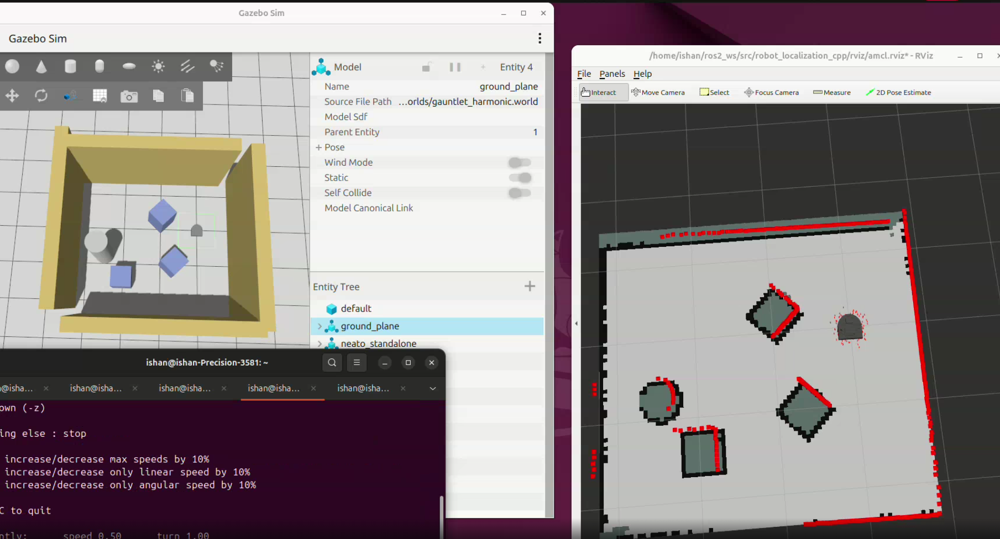

# State Estimation and Localization Project

**Authors:** Ishan Porwal, Ahan Trivedi  
**Course:** Olin College — ENGR3590 Computational Introduction to Robotics  
**Code:** [robot_localization_cpp](https://github.com/ishanporwal/robot_localization_cpp) | **Assignment:** [Robot Localization](https://comprobo26.github.io/assignments/robot_localization)

## Project Overview

The goal of this project was to implement a particle filter that could estimate a Neato robot's position and orientation on a known map. Instead of relying entirely on odometry, which accumulates error over time, we wanted to combine the robot's movement estimates with LiDAR measurements to figure out where it was in the environment.

We implemented the filter in **C++ with ROS 2 Jazzy** and tested it using the Neato simulation in Gazebo. We first generated an occupancy grid using SLAM Toolbox, then used that map to compare the robot's laser measurements against nearby obstacles. Our final implementation covers particle initialization, movement updates, laser-based weighting, pose estimation, and resampling. We also wrote unit tests for the main algorithm steps and recorded several experiments to examine how the filter behaved under different ICs.

The biggest takeaway was that getting each part of the algorithm working was only half the problem. Testing and debugging our particle filter was where the real learning occured. The most useful realization we got from this project was the importance of understanding WHY specific noise injections work when modelling real-world systems. 

## Approach to State Estimation

### Algorithm Overview

A particle represents one possible robot pose (in the map frame) along with a weight indicating how likely that pose is. We maintain **300 particles** and repeatedly update them as the robot moves:

1. **Initialization:** Generate particles around an estimated starting pose using Gaussian noise. If a pose is supplied through RViz's **2D Pose Estimate**, we initialize around that pose. Otherwise, the implementation initializes around the first available odometry pose.
2. **Motion update:** Find the change in odometry since the previous update, convert the translation into the robot's local frame, and apply it according to each particle's orientation. Add Gaussian noise to account for uncertainty in movement.
3. **Laser update:** For each particle, project a LiDAR measurement into the map and look up the distance from that predicted hit location to the nearest mapped obstacle. Assign higher weights to particles whose predicted measurements land near obstacles.
4. **Pose estimate:** Compute the weighted average of particle positions and use the weighted sine and cosine of their headings to estimate orientation. Use that pose to update the `map` → `odom` transform. his allows us to correct the robot's global position without modifying the underlying odometry data, keeping local odometry continuous even as the global position estimate is corrected.
5. **Resampling:** Sample particles with replacement according to their normalized weights so that more likely positions are represented more often in the next iteration.

This repeats when the robot has moved far enough for another update, rather than recalculating the full filter for every scan.

### Implementation Design

A few decisions shaped our implementation:

- **Fixed particle count:** We use 300 particles to keep the processing demands feasible while still representing uncertainty around the robot's pose. This count is fixed.
- **Movement thresholds:** The filter performs a full update after more than **0.2 m** of displacement along either odometry axis or **30°** of rotation. This avoids doing the more expensive weighting and resampling steps for every small movement.
- **Motion noise:** After applying the odometry change, we add independent Gaussian noise with a standard deviation of **0.1 m** in `x` and `y`, and **0.1 radians** in heading. This prevents all particles from following exactly the same predicted path.
- **Likelihood field:** We use the provided occupancy-field helper, which stores the distance to the nearest occupied map cell. This lets us evaluate a hypothetical laser hit without simulating an entire laser ray through the map.
- **One LiDAR reading per update:** Our laser weighting currently uses the measurement at **index 8** rather than a larger subset of the scan. This made the weighting step easier to implement and test independently, but it is also the biggest limitation. One reading provides limited information about the robot's actual pose, especially in parts of the environment that look similar. However, it still proved to be effective.
- **Angle handling:** We normalize angles during motion updates and estimate heading using a circular mean. This avoids incorrect averages when headings fall on opposite sides of the `-π` / `+π` boundary.

The main algorithm is implemented in [`src/pf.cpp`](src/pf.cpp), with transform utilities in [`src/helper_functions.cpp`](src/helper_functions.cpp) and occupancy-grid lookup logic in [`src/occupancy_field.cpp`](src/occupancy_field.cpp).

### Unit Test Design and Integration

We used **Google Test** to test individual parts of the filter before relying on full simulation runs. Our tests are in [`test/test_pf.cpp`](test/test_pf.cpp) and cover:

| Test | What it checks |
| --- | --- |
| `Initialization` | Creates 300 particles with equal normalized weights |
| `AngleWraparound` | Crossing from about +179° to -179° doesn't wrongly trigger a rotation update |
| `Odometry` | Moves particles in their heading, with small random variation |
| `LaserUpdate` | In a small occupancy grid, a particle whose predicted hit is closer to an obstacle receives a higher weight |
| `PoseEstimate` | The estimated position matches the weighted average of known particle positions |
| `Resampling` | A particle with all the probability is selected when resampling, and the resulting weights are uniform |

To build and run these tests:

```bash
cd ~/ros2_ws
colcon build --symlink-install --packages-select robot_localization_cpp
colcon test --packages-select robot_localization_cpp
colcon test-result --verbose
```

These tests cover the individual algorithm steps. They do not, by themselves, prove that the full filter localizes accurately in every environment, which is why we also tested the system in Gazebo and recorded ROS bags.

### Experimental Design

We tested the particle filter in the **Gazebo Neato gauntlet world** using an occupancy grid we saved from SLAM Toolbox (`gauntlet_map.yaml` and `gauntlet_map.pgm`). We drove the simulated Neato using `teleop_twist_keyboard`, while RViz displayed the occupancy map, LiDAR scans, and particle cloud.

We recorded three runs, available under [`bags/`](bags/):

| Recording | Initial condition | What we were testing |
| --- | --- | --- |
| [`good_initial_pose`](bags/good_initial_pose/) | Initial pose supplied near the robot's actual location | Whether the filter could maintain a useful estimate while moving |
| [`bad_initial_pose`](bags/bad_initial_pose/) | Initial position intentionally offset from the actual robot | Whether the filter could recover from an inaccurate starting guess |
| [`no_initial_pose`](bags/no_initial_pose/) | No manual `2D Pose Estimate` message during recording | How the filter behaved using its default odometry-based initialization |

The third recording is approximately **45 seconds** long and includes LiDAR, odometry, particle-cloud, map, and transform data. It has **zero `/initialpose` messages**, which is consistent with the test setup.

#### Demo: Gazebo and RViz

The following demo shows the Gazebo world on the left and the RViz localization view on the right. As the Neato moves, the particle cloud and LiDAR visualization update on the saved occupancy grid.

<p align="center">
  
</p>

[Watch the full particle filter demo (MP4)](media/particle_filter_demo.mp4)
*Screenshot from the recorded demo, showing the simulated environment and the localization display.*

The demo shows that the ROS pipeline is running and the filter is publishing particles as the robot moves. However, some laser returns do not line up perfectly with the mapped walls and obstacles, and the particle distribution can shift as the robot moves. We therefore treat these runs as evidence of a functioning implementation and useful debugging data. 

## Challenges and Next Steps

One of the biggest challenges was debugging ROS coordinate frames and simulation time. At one point, RViz showed LiDAR readings scattered far outside the mapped environment, while the AMCL terminal repeatedly printed `TF_OLD_DATA` warnings. We initially investigated the map and transforms, but checking the `/scan` timestamps showed that messages were jumping backward and forward by hundreds of seconds. Eventually, we found **multiple Gazebo server processes** running at the same time. They were feeding overlapping sensor streams into the same ROS bridge. Stopping and restarting a single simulation fixed that underlying issue.

If we had more time, we would:

- Use multiple LiDAR beams distributed around the scan and combine their likelihoods with a better error allocation system.
- Tune motion noise based on how far the robot actually travels or turns, rather than using fixed noise values.

## Learning Objectives and Final Takeaways

This project gave us a much better understanding of how localization works beyond just calling an existing ROS packages. We had to think through odometry, how uncertainty should be represented, and how LiDAR measurements can improve an estimate that would otherwise drift over time.

A few lessons stood out. First, visualizing intermediate data matters. RViz made it possible to tell whether we were dealing with an algorithm issue. Second, unit tests and full-system tests serve different purposes. A weighted-average calculation can be correct on a small test case while the complete robot still behaves poorly. Finally, recording ROS bags made debugging much more repeatable, since we could replay the same sensor data without needing to drive the robot again in sim.

## How To Run

These commands assume **Ubuntu with ROS 2 Jazzy** and a workspace at `~/ros2_ws`. You also need the CompRobo Neato Gazebo package and the standard ROS 2 navigation/visualization dependencies installed.

### Build

```bash
cd ~/ros2_ws/src
git clone https://github.com/ishanporwal/robot_localization_cpp.git
cd ~/ros2_ws
colcon build --symlink-install --packages-select robot_localization_cpp
source ~/ros2_ws/install/setup.bash
```

If you have already cloned this repository, skip the `git clone` step.

### Run in simulation

Open these commands in **separate terminals**, in order:

**Terminal 1 — Gazebo**

```bash
source ~/ros2_ws/install/setup.bash
ros2 launch neato2_gazebo neato_gauntlet_world.py
```

**Terminal 2 — C++ particle filter and map server**

```bash
source ~/ros2_ws/install/setup.bash
ros2 launch robot_localization_cpp test_pf.py map_yaml:=$HOME/ros2_ws/src/robot_localization_cpp/gauntlet_map.yaml
```

**Terminal 3 — RViz**

```bash
source ~/ros2_ws/install/setup.bash
rviz2 -d ~/ros2_ws/src/robot_localization_cpp/rviz/amcl.rviz
```

**Terminal 4 — Keyboard teleoperation**

```bash
ros2 run teleop_twist_keyboard teleop_twist_keyboard
```

In RViz, use **2D Pose Estimate** to initialize the filter near the simulated robot, then drive using the keyboard controls. Stop older Gazebo and AMCL instances before launching this setup to avoid conflicting ROS topics.

### Replay a recorded experiment

Stop Gazebo and the live particle filter first, then open RViz with simulation time enabled:

```bash
source ~/ros2_ws/install/setup.bash
rviz2 -d ~/ros2_ws/src/robot_localization_cpp/rviz/amcl.rviz --ros-args -p use_sim_time:=true
```

In a second terminal, run (replace the bag folder to try a different test):

```bash
cd ~/ros2_ws/src/robot_localization_cpp
ros2 bag play bags/no_initial_pose --clock
```

The ROS bag already includes the recorded particle cloud, so the particle filter does not need to run again just to visualize that recording.
